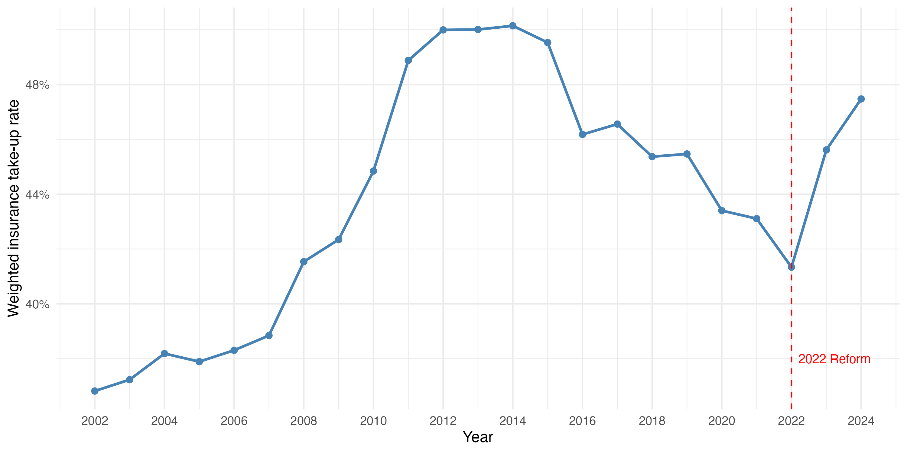
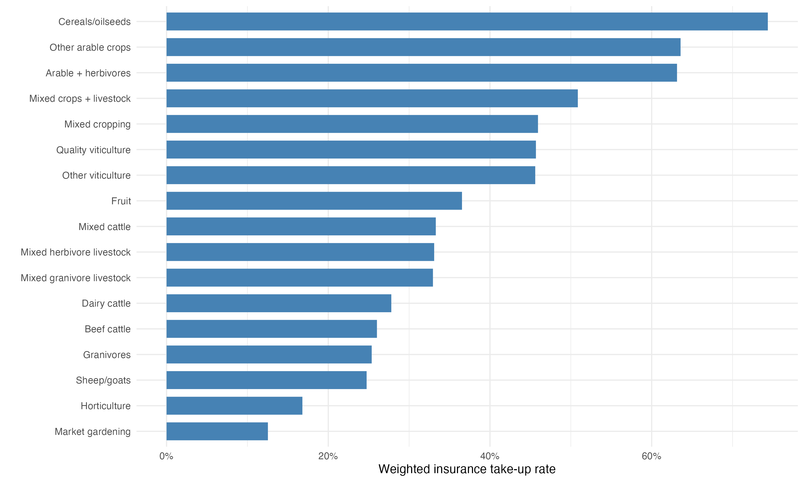
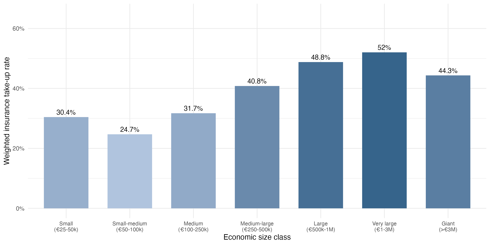
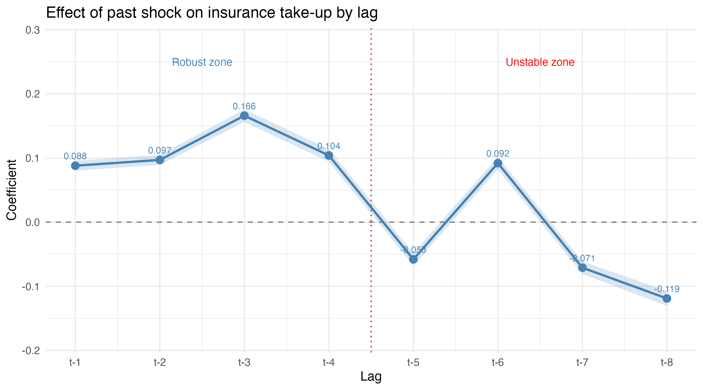

# Do Farmers Learn from Climate Shocks?
### Evidence from French Agricultural Data

Master's thesis in Quantitative Economics — Université Paris Dauphine–PSL, 2026.

**Author:** El Ghali Debbagh

[Read the full master's thesis (PDF)](report/master_thesis.pdf)

## Project overview

This research investigates the determinants of crop insurance take-up among French agricultural holdings, with a particular focus on the role of past climate shocks in farmers' insurance decisions.

The project covers the entire statistical workflow, from raw data processing and longitudinal database construction to descriptive statistics, econometric modelling and interpretation of results.

## Key figures

| Indicator | Value |
|---|---:|
| Available annual microdata files | 25 |
| Total available raw data volume | Approx. 500 MB |
| Annual datasets used | 23 |
| Raw observations | Approx. 169,000 |
| Final panel observations | 143,130 |
| Agricultural holdings | 19,792 |
| R scripts | 8 |

## Data

The analysis relies on French Farm Accountancy Data Network (RICA) microdata published by Agreste, covering the period 2002–2024.

The original data collection covers 2000–2024 and includes annual files in TXT and CSV formats.

See the [data documentation](data/README.md) for further information on data sources, access and processing.

## Data processing

All statistical analyses and data processing were conducted in R.

The main steps include:

- Importing and combining annual microdata files
- Harmonising variables across survey years
- Cleaning and validating individual identifiers
- Handling missing values and inconsistent observations
- Harmonising geographical classifications
- Constructing a longitudinal panel
- Creating indicators and explanatory variables
- Accounting for survey weights
- Analysing sample composition and attrition

### Data quality and validation

Particular attention was paid to the consistency of agricultural holding identifiers across survey years and the reliability of the longitudinal database.

Selected validation outputs:

- [Identifier overlap across years](results/tab_idnum_chevauchement.png)
- [Identifier stability](results/tab_idnum_stabilite.png)
- [Panel participation distribution](results/tab_idnum_distribution.png)
- [Correlation checks](results/tab_idnum_correlations.png)

## Selected data visualisations

### Evolution of crop insurance take-up

### Insurance take-up by type of farming

### Insurance take-up by economic size

Additional visualisations are available in the [figures directory](figures/).

## Statistical and econometric methods

- Weighted descriptive statistics
- Data visualisation
- Probit models
- Propensity score estimation
- Individual and time fixed effects
- Heterogeneity analysis
- Robustness checks

### Dynamic analysis of past climate shocks

Additional estimation results are available in the [results directory](results/).

## Technical skills

| Area | Skills |
|---|---|
| Programming | R |
| Data management | Data cleaning, wrangling, merging and harmonisation |
| Data quality | Identifier validation, consistency checks and missing data |
| Survey statistics | Microdata, survey weights and descriptive statistics |
| Longitudinal data | Panel construction and attrition analysis |
| Statistical modelling | Probit, propensity scores and fixed effects |
| Data visualisation | Statistical charts and result presentation |
| Documentation | Technical documentation and research reporting |

## Repository structure

| Directory | Content |
|---|---|
| [data/](data/) | Data sources and processing documentation |
| [scripts/](scripts/) | R scripts and technical documentation |
| [figures/](figures/) | Selected statistical visualisations |
| [results/](results/) | Data validation and econometric results |
| [report/](report/) | Full master's thesis |

## Data availability and reproducibility

The original datasets are available through Agreste.

Raw microdata and intermediate datasets are not distributed in this repository. Redistribution conditions must be verified before including these files.

All eight R scripts have been successfully executed sequentially in a clean R session using R 4.2.2. Package versions and software environment details are available in [sessionInfo.txt](sessionInfo.txt).

One lag-specific regression produces a convergence warning, and standard errors may differ across versions of `fixest`. The original econometric specifications have been retained.

## Author

El Ghali Debbagh

Master's in Quantitative Economics — Université Paris Dauphine–PSL

[LinkedIn](https://www.linkedin.com/in/elghalidebbagh/)
